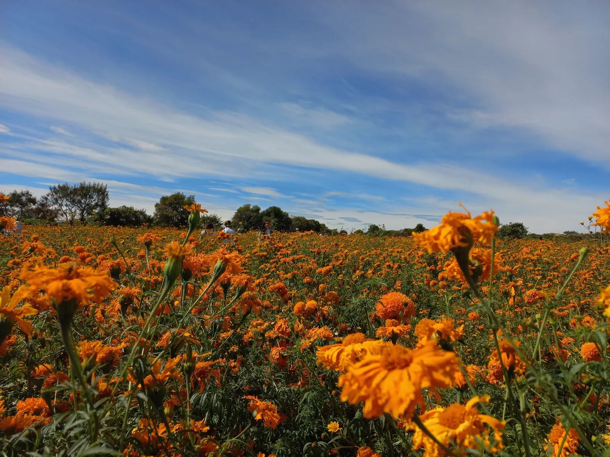
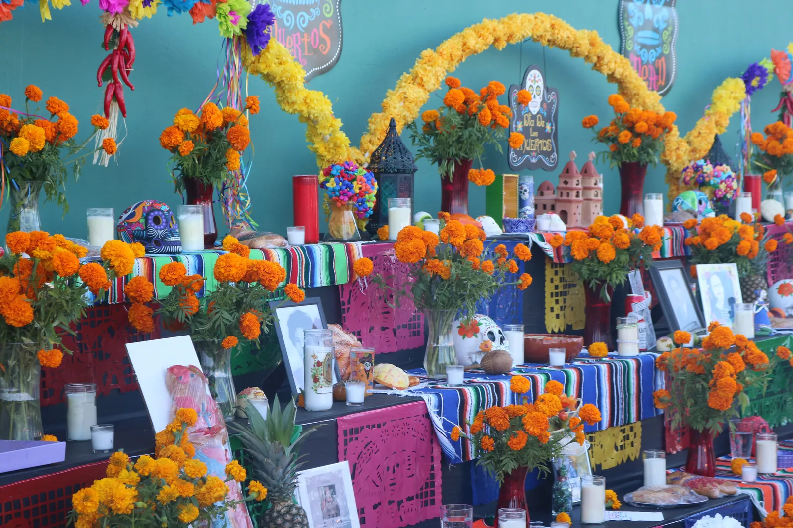

**Día de los Muertos 2026 takes place on Sunday, Nov. 1 and Monday, Nov. 2.** The Mexican tradition remembers family members and friends who have died with ofrendas (home altars), marigolds, candles, food and cemetery visits. Both days fall right after Halloween on Saturday, Oct. 31, and many families start earlier: popular calendars reported by Mexican newsrooms set aside Tuesday, Oct. 27 for pets.

## Day of the Dead 2026 dates at a glance

| Date | Day | Observance |
|---|---|---|
| Oct. 27 | Tuesday | Pets that have died (a recent popular custom) |
| Oct. 31 | Saturday | Halloween; many families finish their ofrendas; Mexico City parade |
| Nov. 1 | Sunday | Día de los Angelitos (children); All Saints' Day |
| Nov. 2 | Monday | Día de los Muertos (adults); All Souls' Day |

The main dates are fixed every year. Only the weekday moves: in 2026 the two central days land on a Sunday and a Monday, so the cemetery visits of Nov. 1 fall on a weekend and Nov. 2 is a regular workday in the United States.

## The week before: Oct. 27 to Nov. 2, day by day

Mexico's Ministry of Culture lists the festivity from Oct. 28 to Nov. 3, with the faithful departed remembered on Nov. 1 and 2. Many families follow a longer popular calendar that gives each day to a different group of the dead. Two Mexican newsrooms, La Crónica de Hoy and Récord, published the same sequence for 2026, and Récord notes that it comes from popular calendars that vary by region and family.

| Date | Day | Who is remembered, by popular calendar |
|---|---|---|
| Oct. 27 | Tuesday | Pets |
| Oct. 28 | Wednesday | People who died in accidents, violence or other tragic circumstances |
| Oct. 29 | Thursday | Forgotten souls with no one to remember them |
| Oct. 30 | Friday | Lonely and forgotten souls (continued) |
| Oct. 31 | Saturday | Children who died before birth or before baptism |
| Nov. 1 | Sunday | Children and young people, the angelitos |
| Nov. 2 | Monday | Adults; the Day of the Faithful Departed |

Treat the table as one common pattern. A family in Oaxaca, a town in Michoacán and a household in Chicago may set up and take down their altars on different days, and that is part of the tradition.

## What Día de los Muertos means

Día de los Muertos is a Mexican tradition, rooted in Indigenous practice and blended with the Catholic feasts of All Saints and All Souls. Families welcome back the spirits of relatives who have died. The United Nations Educational, Scientific and Cultural Organization (UNESCO) first proclaimed the Indigenous festivity dedicated to the dead a masterpiece of intangible heritage in 2003 and inscribed it on its Representative List of the Intangible Cultural Heritage of Humanity in 2008. UNESCO describes families laying flower petals, candles and offerings along the path from the cemetery to the home to guide the souls back.

In many places families spend the night of Nov. 1 or Nov. 2 at the cemetery, cleaning and decorating graves, sharing food and telling stories about the people they remember. UNESCO's own short film shows these customs in Indigenous communities:

<figure class="video-embed">
<iframe src="https://www.youtube-nocookie.com/embed/GwXMaxfI4As" title="The Indigenous Festivity dedicated to the Dead, a UNESCO video" loading="lazy" allow="encrypted-media; picture-in-picture; fullscreen" allowfullscreen referrerpolicy="strict-origin-when-cross-origin" style="display:block;width:100%;aspect-ratio:16/9;height:auto;border:0;border-radius:12px;background:#111"></iframe>
<figcaption>"The Indigenous Festivity dedicated to the Dead," a video by UNESCO on its YouTube channel.</figcaption>
</figure>

## How to build an ofrenda

The ofrenda, a home altar, is the center of the celebration. There is no single required design; families pick the things that meant something to the person they remember. Common elements:

| Element | What it is | Why it is there |
|---|---|---|
| Photos | Pictures of the people being remembered | Show whom the altar is for |
| Cempasúchil | Orange Mexican marigolds, loose petals and garlands | Color and scent said to guide the spirits home |
| Candles | Veladoras, often one per person | Light the way |
| Food and drink | The person's favorite dishes | A welcome after the journey |
| Pan de muerto | Sweet bread topped with dough "bones" | The bread of the season |
| Calaveras | Sugar skulls, often with a name on the forehead | Remembrance with humor |
| Papel picado | Cut-paper banners | Color and movement |
| Water and salt | A glass of water, a small dish of salt | For thirst and the journey |
| Personal objects | A book, a hat, a tool, an instrument | The person's own story |

*Cempasúchil growing in Atlixco, Puebla, on Oct. 24, 2021 (file photo). The flowers are cut in late October for altars and graves. Photo: B.jars, [Creative Commons Attribution-ShareAlike 4.0](https://creativecommons.org/licenses/by-sa/4.0), via [Wikimedia Commons](https://commons.wikimedia.org/wiki/File:Campos_de_Cempas%C3%BAchil.jpg).*

Altars usually go up in the last week of October. Pan de muerto is the bread of the season; on Nov. 1, 2018, Mexico City's government handed it out at the Panteones Metro station, where the photo below was taken.

*Pan de muerto at a Mexico City government handout, Nov. 1, 2018 (file photo). Photo: Mexico City government, [CC0](https://creativecommons.org/publicdomain/zero/1.0/), via [Wikimedia Commons](https://commons.wikimedia.org/wiki/File:Entrega_de_pan_de_muerto_2991_%2846061194481%29.jpg), cropped.*

## Day of the Dead for pets: why Oct. 27

Mexican newsrooms including Infobae and Expansión report Oct. 27 as the day families remember dogs, cats and other animals that have died. Expansión, citing tradition, says the pet ofrenda should be ready by the night of Oct. 27. Infobae calls it a popular belief that "se popularizó apenas en años recientes," spreading only in recent years, and says the modern custom has a recent rather than ancient origin. It is not an official holiday, and not every family keeps it.

A small pet ofrenda might hold:

- A photo of the pet.
- A favorite toy, collar or blanket.
- Water and a small portion of a favorite treat, placed where living pets cannot reach it.
- Marigolds or another flower, and a candle you can watch.

In 2026 Oct. 27 fell on a Tuesday, so many families set up their pet altar on Monday evening. Our printable below marks the date for next year's planning too.

## Day of the Dead in Mexico City in 2026

Mexico City pairs neighborhood and family customs with a city program of public events. The dates below come from the city government's tourism portal; the [Mexico City Day of the Dead parade guide](/news/mexico-city-day-of-the-dead-parade-2026-october-31-time-route-zocalo-ofrenda/) has the parade route and U.S. times.

| Event | 2026 dates | Where |
|---|---|---|
| Festival Flores de Cempasúchil | Oct. 18 to Nov. 1 | Paseo de la Reforma |
| "El Camino" light installation | Oct. 23 to Nov. 8 | Paseo de la Reforma |
| Ofrenda Monumental | Oct. 29 to Nov. 2 | Zócalo |
| Community ofrendas | Oct. 29 to Nov. 2 | 12 venues around the city |
| Zócalo illumination | Oct. 29 to Nov. 4 | Historic center |
| "La Puerta entre dos mundos" festival | Oct. 29 to Nov. 4 | Chapultepec, Second Section, with a nighttime drone show |
| Gran Desfile de Día de Muertos | Sat., Oct. 31, 2 p.m. (4 p.m. Eastern Time (ET)) | Paseo de la Reforma to the Zócalo |
| San Andrés Mixquic | Oct. 31 to Nov. 2 | Tláhuac; ends with La Alumbrada on Nov. 2 |

Earlier events on the city's list have already taken place: the 18th Desfile de Alebrijes Monumentales on Oct. 17, a night bike ride on Oct. 24 and the Mega Procesión de las Catrinas on Oct. 25. The city's page notes that the Ofrenda Monumental in the Zócalo includes a 32-meter cartonería (papier-mâché) figure. Check the [official city guide](https://mexicocity.cdmx.gob.mx/e/dia-de-muertos-en-la-ciudad-de-mexico/) for closures and changes before you go.

Outside the capital, customs change from state to state and town to town. When visiting a cemetery or a family altar anywhere in Mexico, ask before taking photos of people, graves or private ofrendas.

## Day of the Dead in the United States in 2026

**Día de los Muertos is not a U.S. federal holiday.** The Office of Personnel Management's list does not include it, so on Monday, Nov. 2, 2026, federal offices, banks and the Postal Service keep normal hours. Schools and employers set their own schedules.

It is widely celebrated in U.S. cities, with public altars, parades, art shows and family workshops.

*A community ofrenda at Mission San José, San Antonio Missions National Historical Park, Oct. 29, 2021 (file photo). Photo: National Park Service, public domain, via [Wikimedia Commons](https://commons.wikimedia.org/wiki/File:Ofrenda_or_Day_of_the_Dead_Altar_at_Mission_Marquee_Plaza._%28586908b4-40dd-4be5-bc53-ababb89291f1%29.JPG).*

### San Antonio events still ahead

| Event | 2026 dates and hours | Where | Cost |
|---|---|---|---|
| Calaveras de Azúcar Festival | Sat., Oct. 31, 10 a.m. to 9:30 p.m.; Sun., Nov. 1, 10 a.m. to 8:30 p.m. | Historic Market Square | Free |
| Self-guided altar tour | Daily through Fri., Nov. 6, 10 a.m. to 6 p.m. | Historic Market Square | Free |

Source: City of San Antonio release of Oct. 20, 2026. The River Parade on Oct. 23 and the La Villita festival of Oct. 23 to 25 have taken place.

### Los Angeles events still ahead

| Event | 2026 dates | Where |
|---|---|---|
| Downtown Día de los Muertos altars | Through Mon., Nov. 2, 8 a.m. to 9 p.m. daily | Gloria Molina Grand Park |
| Grand Park closing night | Sun., Nov. 1, 3 to 7 p.m. | Gloria Molina Grand Park |
| Día de los Muertos Festival | Through Mon., Nov. 2 | Olvera Street |
| Plaza de la Familia (Coco theme) | Through Mon., Nov. 2 | Disney California Adventure Park |

The Music Center, which runs Grand Park, says its schedule and artists may change; Discover Los Angeles lists the Olvera Street festival. Hours and tickets differ by venue, so check each organizer's page before you go.

## The 2026 Día de Muertos Barbie

Searches for a "Day of the Dead Barbie" are about Mattel's yearly collector doll, not a film. Mattel Creations lists the **Barbie Signature Día De Muertos 2026 Barbie Doll** in a deep-red satin gown with a mermaid-style skirt, embroidery inspired by traditional Mexican pottery, a sugar-skull-inspired mask and sculpted rose accents. A matching 2026 Ken doll is also listed. On Oct. 30, both showed a price of $80 and pre-orders marked sold out on Mattel's store.

The dolls borrow the season's colors and calavera look; they are collectibles, not part of an ofrenda.

## Coco and other Day of the Dead movies

Pixar's **Coco** is the best-known family film set during Día de los Muertos. A boy named Miguel crosses into the Land of the Dead and learns about his family's past. It is fiction inspired by Mexican traditions and a good way to start a conversation with children, but it does not show how every region keeps the days.

At the Disneyland Resort, Plaza de la Familia at Disney California Adventure uses Coco characters and music; its fact sheet lists the 2026 run from Aug. 21 through Nov. 2.

## Is Day of the Dead the same as Halloween?

No. Halloween on Oct. 31 has Celtic and Christian roots and centers on costumes and trick-or-treating; our [Halloween 2026 guide](/news/halloween-2026-saturday-sunset-trick-or-treat-times/) has sunset times by city. Día de los Muertos is about memory and family: welcoming back relatives who have died. The two sit side by side on the calendar, and some public events mix them, but their meanings differ.

## Printable Day of the Dead 2026 calendar

The free one-page sheet below marks every date in this story on an October and November 2026 grid, with a lined area for the names you want on your ofrenda. It prints on US Letter, and an ink-saver version is included. For a plain month, use our [November 2026 printable calendar](/november-calendars.html) or [October 2026 printable calendar](/october-calendars.html).

## The busy weekend ahead

| Date | What happens |
|---|---|
| Saturday, Oct. 31 | Halloween; Mexico City's Gran Desfile at 2 p.m. local time |
| Sunday, Nov. 1 | Día de los Angelitos; All Saints' Day; U.S. clocks fall back one hour at 2 a.m. ([when daylight saving time ends](/when-is/daylight-savings/)) |
| Monday, Nov. 2 | Día de los Muertos; All Souls' Day |
| Tuesday, Nov. 3 | Election Day |

The [All Saints' Day and All Souls' Day guide](/news/all-saints-day-2026-holy-day-of-obligation-all-souls-day/) covers the church side of Nov. 1 and 2. Día de los Muertos opens a busy month: [Diwali](/news/diwali-2026-date-lakshmi-puja-time-usa/) falls on Sunday, Nov. 8 and Veterans Day on Wednesday, Nov. 11, and every date is in our [November 2026 calendar with holidays](/news/november-2026-important-dates-days-until/). The [when is Halloween](/when-is/halloween/) page gives that date for future years.
