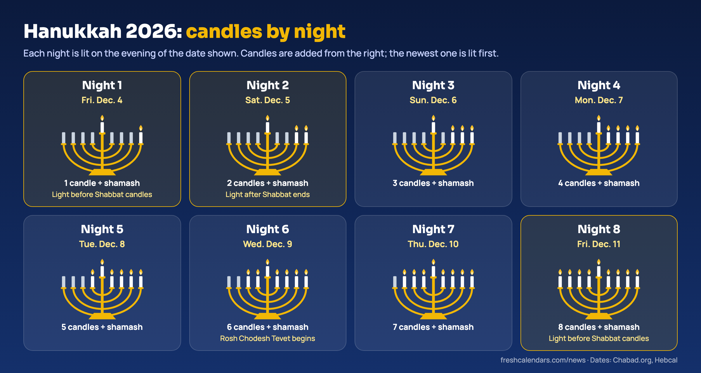
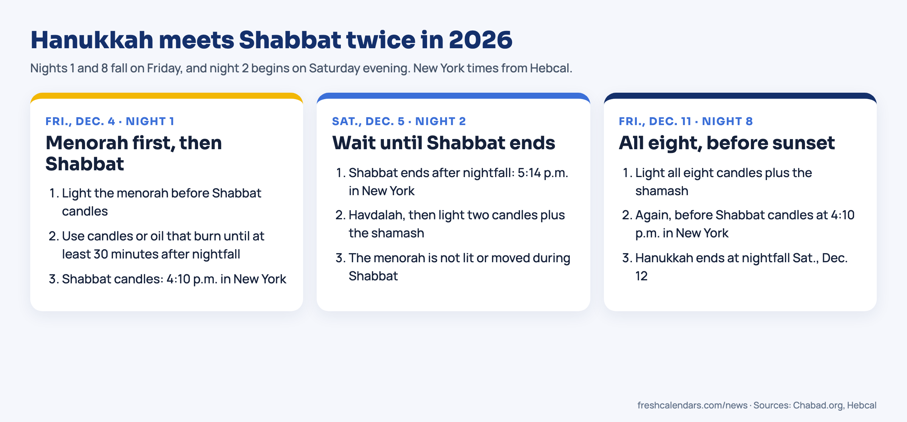

<b>Last updated Oct. 29, 2026, 7:57 a.m. ET.</b> Added first-night lighting times for 20 U.S. cities from Hebcal, up from four.

**The first night of Hanukkah 2026 is Friday, Dec. 4, and the holiday ends at nightfall on Saturday, Dec. 12.** Because that Friday is also the start of Shabbat, the first candle is lit in the late afternoon, before the Shabbat candles: by 4:10 p.m. in New York and 4:25 p.m. in Los Angeles, according to Hebcal. The first candle is lit on Friday evening, and the last of the eight candle-lighting nights starts on Friday, Dec. 11. Both Chabad.org and Hebcal, the online Jewish calendar, list the same dates.

Jewish holidays start at sundown, so the first night of Hanukkah comes before its first day. The first full day is Saturday, Dec. 5, which is 25 Kislev 5787 on the Hebrew calendar. The holiday runs through 2 Tevet.

## Hanukkah 2026 at a glance

| | Date |
|---|---|
| First candle | Friday, Dec. 4, 2026, before Shabbat |
| First full day | Saturday, Dec. 5 (25 Kislev 5787) |
| Last candle-lighting night | Friday, Dec. 11, before Shabbat |
| Holiday ends | Saturday, Dec. 12, at nightfall (2 Tevet 5787) |
| Length | Eight nights and eight days |

## All eight nights of Hanukkah 2026

Each night is lit on the evening of the date in the left column. One candle is added every night, and the shamash, the helper candle used to light the others, is lit every night too.

| Night | Evening of | Candles (plus shamash) | Note |
|---|---|---|---|
| 1 | Friday, Dec. 4 | 1 | Light before Shabbat candles |
| 2 | Saturday, Dec. 5 | 2 | Light after Shabbat ends |
| 3 | Sunday, Dec. 6 | 3 | |
| 4 | Monday, Dec. 7 | 4 | |
| 5 | Tuesday, Dec. 8 | 5 | |
| 6 | Wednesday, Dec. 9 | 6 | Rosh Chodesh Tevet begins |
| 7 | Thursday, Dec. 10 | 7 | |
| 8 | Friday, Dec. 11 | 8 | Light before Shabbat candles |

*Night by night: candles go into the menorah from the right, and the newest one, on the left, is lit first.*

Rosh Chodesh Tevet, the start of the Hebrew month, falls inside Hanukkah this year. Hebcal lists it on Thursday, Dec. 10 and Friday, Dec. 11, so it begins on the evening of night 6.

## Hanukkah starts and ends on Shabbat this year

Hanukkah 2026 overlaps two Shabbats. That changes the lighting order on three of the eight nights, and it matters most on the Fridays, when the menorah has to be lit early in the afternoon, before the Shabbat candles, with lights big enough to keep burning well into the evening. Chabad's guide to lighting the menorah gives these rules:

- **Friday, Dec. 4 and Friday, Dec. 11.** Light the menorah first, then the Shabbat candles, which are lit 18 minutes before sunset. Use larger candles or extra oil, because the lights must burn until at least half an hour after nightfall. Standard small Hanukkah candles may not last that long.
- **Saturday, Dec. 5.** Wait until Shabbat ends after nightfall. Say Havdalah, the prayer that closes Shabbat, then light two candles and the shamash.
- **During Shabbat.** The menorah is not lit again or moved.

*Three nights with a different order. Times are for New York from Hebcal; check your own city.*

### First-night lighting times in 20 U.S. cities

Hebcal publishes Shabbat candle-lighting times at 18 minutes before sunset and the end of Shabbat (Havdalah) at nightfall. On the two Fridays the menorah is lit before the Shabbat time below; on Saturday, Dec. 5 it is lit after Shabbat ends. All times are local standard time, grouped by time zone from east to west.

| City | Time zone | Night 1, Fri., Dec. 4: light before | Night 2, Sat., Dec. 5: light after | Night 8, Fri., Dec. 11: light before |
|---|---|---|---|---|
| Boston | Eastern | 3:53 p.m. | 4:58 p.m. | 3:53 p.m. |
| New York | Eastern | 4:10 p.m. | 5:14 p.m. | 4:10 p.m. |
| Philadelphia | Eastern | 4:17 p.m. | 5:20 p.m. | 4:17 p.m. |
| Baltimore | Eastern | 4:25 p.m. | 5:27 p.m. | 4:25 p.m. |
| Washington, D.C. | Eastern | 4:28 p.m. | 5:30 p.m. | 4:28 p.m. |
| Pittsburgh | Eastern | 4:35 p.m. | 5:38 p.m. | 4:35 p.m. |
| Cleveland | Eastern | 4:39 p.m. | 5:43 p.m. | 4:38 p.m. |
| Detroit | Eastern | 4:41 p.m. | 5:46 p.m. | 4:41 p.m. |
| Atlanta | Eastern | 5:10 p.m. | 6:09 p.m. | 5:11 p.m. |
| Miami | Eastern | 5:11 p.m. | 6:07 p.m. | 5:12 p.m. |
| Chicago | Central | 4:01 p.m. | 5:06 p.m. | 4:01 p.m. |
| Minneapolis | Central | 4:14 p.m. | 5:21 p.m. | 4:13 p.m. |
| Dallas | Central | 5:02 p.m. | 6:01 p.m. | 5:03 p.m. |
| Houston | Central | 5:03 p.m. | 6:00 p.m. | 5:04 p.m. |
| Denver | Mountain | 4:17 p.m. | 5:20 p.m. | 4:17 p.m. |
| Phoenix | Mountain | 5:02 p.m. | 6:00 p.m. | 5:02 p.m. |
| Seattle | Pacific | 4:00 p.m. | 5:10 p.m. | 3:59 p.m. |
| Las Vegas | Pacific | 4:07 p.m. | 5:07 p.m. | 4:08 p.m. |
| San Francisco | Pacific | 4:32 p.m. | 5:33 p.m. | 4:32 p.m. |
| Los Angeles | Pacific | 4:25 p.m. | 5:24 p.m. | 4:26 p.m. |

Boston has the earliest first-night deadline on the list, 3:53 p.m., and Atlanta and Miami the latest in the Eastern zone, past 5:10 p.m., because they sit at the western edge of the zone or farther south. Your synagogue may use a different custom, such as lighting Shabbat candles earlier, so its local calendar comes first.

Early December has some of the earliest sunsets of the year, which is why New York's time barely moves between the two Fridays. Our story on [sunset times after daylight saving time ends](/news/sunset-times-after-daylight-saving-time-ends-2026/) explains the pattern.

## What Hanukkah marks

Hanukkah, also spelled Chanukah, recalls events in the second century Before the Common Era (BCE). Chabad.org's account says the Seleucid Greek rulers of the Land of Israel tried to stop Jewish religious practice. A small Jewish force led by Judah the Maccabee won back Jerusalem and rededicated the Second Temple on 25 Kislev.

When they went to light the Temple menorah, they found one jar of pure olive oil, enough for a single day. It burned for eight days. That is the miracle. It is why the holiday lasts eight nights and why families add one light each evening. Foods fried in oil, such as latkes and jelly doughnuts, and the dreidel game are part of the holiday at home.

## How many candles you need

Plan on 44. A standard box of 44 candles covers the whole holiday. The arithmetic: nights 1 through 8 use 1 + 2 + 3 + 4 + 5 + 6 + 7 + 8 = 36 candles, and the shamash adds one more each night, for 8 more.

For the two Friday nights, Chabad advises lights that last until at least 30 minutes after nightfall, counted from a lighting time before sunset. If your candles are the short kind, buy a few larger ones or use oil for Dec. 4 and Dec. 11.

Shipping gifts? Our story on [holiday shipping deadlines](/news/usps-holiday-shipping-deadlines-2026/) from the U.S. Postal Service lists the late-November dates to mail packages meant for the first night.

## Free Hanukkah 2026 printables

The four sheets below are free to print on US Letter paper:

- **Hanukkah 2026 Calendar.** December 2026 with all eight nights marked, the candle count for each one and the Friday and Saturday rules. There is room for family plans under the grid.
- **Monday-start version** for anyone whose planner begins the week on Monday.
- **Ink-saver version** in black and white for home printers.
- **Eight Nights Planner.** A check box for each night, columns for gifts and for meals and guests, the Shabbat times above and a shopping checklist.

For the rest of the month, our [December 2026 calendar](/december-calendars.html) has blank, holiday and weekly layouts. The [winter break 2026 dates](/news/winter-break-2026-school-districts-dates/) story shows when large school districts close, which helps with planning the later nights.

## Is Hanukkah a federal holiday?

No. The U.S. Office of Personnel Management (OPM) federal holiday list for 2026 does not include Hanukkah. Federal offices and the U.S. Postal Service keep their normal schedules from Dec. 4 to Dec. 12. Christmas Day, Friday, Dec. 25, is the next federal holiday, two weeks after Hanukkah ends.

## Hanukkah in future years

Because the Hebrew calendar follows both the moon and the sun, Hanukkah moves around on the Gregorian calendar. Chabad.org lists these dates:

| Year | Begins at sundown | Ends at nightfall |
|---|---|---|
| 2026 | Friday, Dec. 4 | Saturday, Dec. 12 |
| 2027 | Friday, Dec. 24 | Saturday, Jan. 1, 2028 |
| 2028 | Tuesday, Dec. 12 | Wednesday, Dec. 20 |

In 2027 the first candle falls on Christmas Eve, and the last day lands on New Year's Day.

<b>Public menorah lightings:</b> The 2026 date for the National Menorah lighting on the Ellipse in Washington has not been announced. Last year's ceremony was held on Dec. 14, 2025, according to the organizers, American Friends of Lubavitch.

