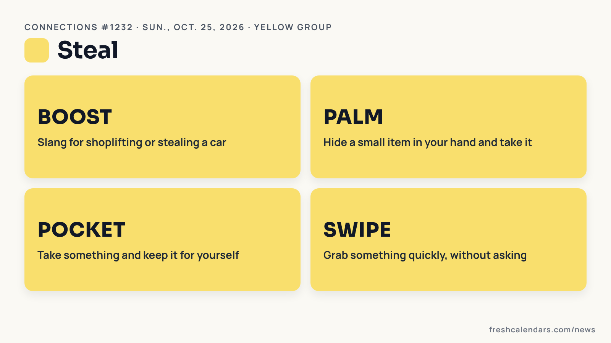
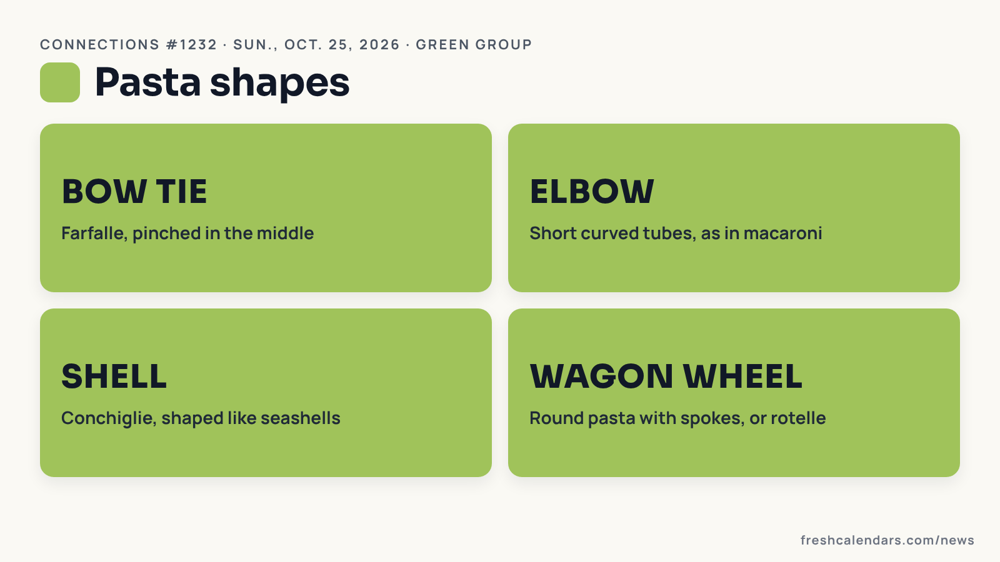
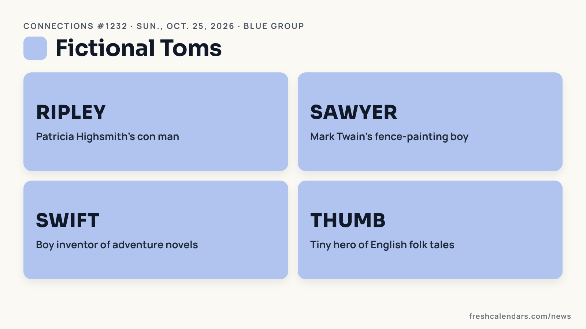
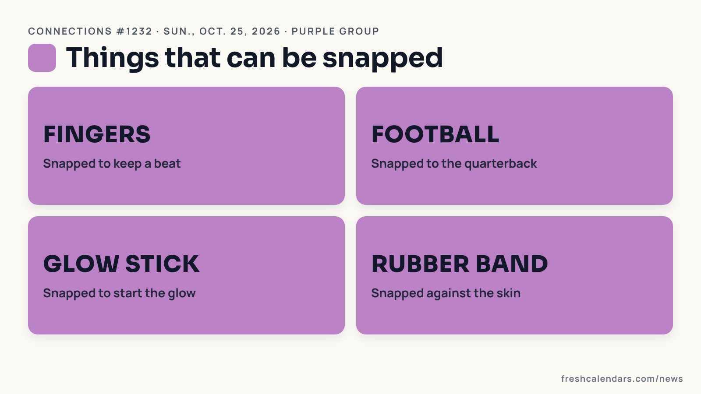

**Connections #1232 from The New York Times (NYT), for Sunday, Oct. 25, 2026, rewards knowing more than one meaning of a word: four entries look like body parts, and one word, snap, is used in four different senses.** Below we go through all 16 words: what each one means, why it belongs in its group and where it tries to trick you. If you want to keep solving, use our [Connections hints for Oct. 25](/news/nyt-connections-hints-answers-october-25-2026-1232/) instead; everything after the next heading is a spoiler.

## Today's 16 words

Boost, Bow Tie, Elbow, Fingers, Football, Glow Stick, Palm, Pocket, Ripley, Rubber Band, Sawyer, Shell, Swift, Swipe, Thumb, Wagon Wheel

## Why these words are tricky

Most entries have an everyday meaning and a second one the puzzle uses. Palm, Elbow, Fingers and Thumb read as body parts, which pulls them into a group that does not exist. Swift sounds like a pop star, Shell like the beach, and Boost like an energy drink. The fix is to ask what else each word can mean, and whether it works as a verb.

Keep a streak log on our [printable weekly calendar](/printable-weekly-calendar.html) or the [October 2026 printable calendar](/october-calendars.html).

## What every word means (spoilers)

Stop here if you still want to solve the puzzle yourself.

### Yellow: Steal

- **Boost:** in slang, to steal, especially to shoplift or to take a car.
- **Palm:** to hide a small object in your hand and take it, a pickpocket's or magician's move.
- **Pocket:** to take something, often money, and keep it for yourself.
- **Swipe:** to grab something quickly and take it without asking.

All four work as verbs here, which is the giveaway. Palm is the trap, since it is also one of the body parts.

### Green: Pasta Shapes

- **Bow tie:** farfalle, flat pasta pinched in the middle like a bow.
- **Elbow:** short curved tubes, the shape of elbow macaroni.
- **Shell:** conchiglie, pasta shaped like small seashells.
- **Wagon wheel:** round pasta with spokes, sold as rotelle or ruote.

Elbow is the body part that belongs here.

### Blue: Fictional Toms

- **Ripley:** Tom Ripley, the charming con man of Patricia Highsmith's novels, starting with "The Talented Mr. Ripley."
- **Sawyer:** Tom Sawyer, Mark Twain's boy from the Mississippi River town who talks his friends into painting a fence.
- **Swift:** Tom Swift, the teenage inventor hero of a long series of adventure books.
- **Thumb:** Tom Thumb, the boy no bigger than his father's thumb in English folk tales.

Each word is a surname or nickname that follows "Tom." Swift is the decoy, because it suggests a singer first.

### Purple: Things That Can Be Snapped

- **Fingers:** snapped together to make a click, to keep a beat or get attention.
- **Football:** snapped back to the quarterback to start a play.
- **Glow stick:** snapped, bending it until the inner capsule breaks, so it starts to glow.
- **Rubber band:** snapped by stretching it and letting go.

Snap means something different each time: a sound, a handoff, a break and a sting. Fingers is the fourth body part, placed here to finish the trap.

More puzzle help for the day: [Connections: Sports Edition #762](/news/nyt-connections-sports-edition-hints-answers-october-25-2026-762/), and for tomorrow, [Connections #1233 hints](/news/nyt-connections-hints-answers-october-26-2026-1233/). The groups above come from the puzzle's official data.
