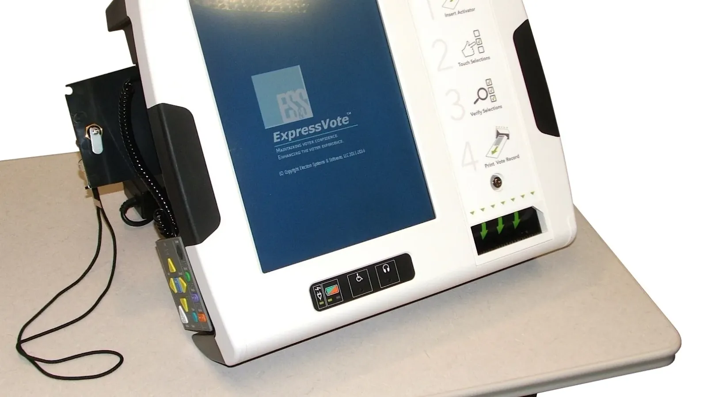
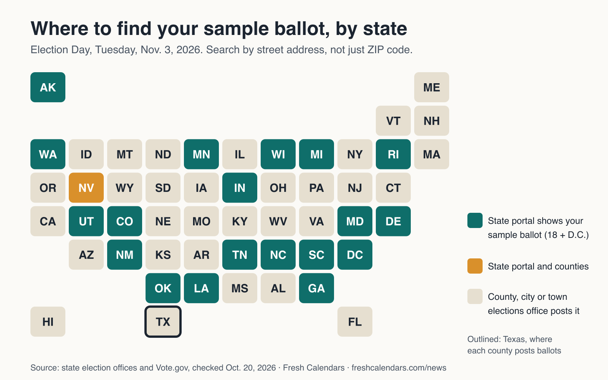
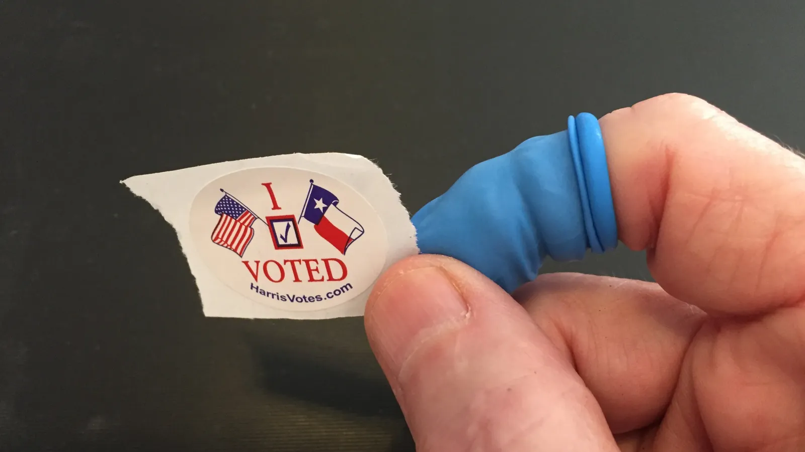

<b>Last updated Oct. 29, 2026, 3:50 a.m. ET.</b> Added which large Texas counties use vote centers on Election Day, the state's early voting turnout and registration figures, and a state-by-state map of where sample ballots are posted.

**To find the sample ballot for your ZIP code, enter your ZIP code below to get your state's official lookup for Nov. 3, 2026, then search there by street address and print your choices on our free worksheet.** Your sample ballot shows exactly what you will vote on, and in most of the country you can see it online today. In Texas, early voting runs through Friday, Oct. 30, according to the Texas Secretary of State, and sample ballots come from each county elections office rather than the state. On Election Day, Tuesday, Nov. 3, polls are open 7 a.m. to 7 p.m. statewide. Below: why a ZIP code alone can show the wrong races, the official lookup for every state, links for 12 large Texas counties, and free printables to take your choices with you.

## Find your sample ballot by ZIP code

<form class="zip-finder" data-zip-finder action="#state-lookups" onsubmit="return false" novalidate>
<label for="zip-in">Enter your five-digit ZIP code</label>
<input id="zip-in" name="zip" inputmode="numeric" pattern="[0-9]{5}" maxlength="5" autocomplete="postal-code" placeholder="77002">
<button type="submit">Find my ballot site</button>

</form>

The finder matches the first three digits of your ZIP code to a state using Postal Service prefixes and points you to that state's official lookup in the table below. It does not store or send your ZIP code anywhere. A handful of ZIP codes near state lines cross into a neighboring state; if the result looks wrong, pick your state in the table.

## Why a ZIP code is not enough

ZIP codes are drawn by the Postal Service for delivering mail. Election districts are drawn separately, so one ZIP code can cross two congressional districts, several state legislative districts, different school boards and city limits. Two neighbors with the same ZIP code can have different ballots.

That is why official lookups ask for your street address, or for your name and date of birth so they can match you to your precinct. If a site asks only for a ZIP code, treat its ballot as a rough preview.

## How to read your sample ballot

A sample ballot shows the same contests, in the same order, as the ballot you will vote on. Each race tells you how many choices you can make, such as one candidate for governor or more than one for a school board. Ballot measures, called propositions, amendments or questions depending on the state, are a yes-or-no choice, so read the measure's own wording, not just its number.

*A touch-screen ballot-marking device of the kind many counties use; voters touch their choices, review them and print the record. Your sample ballot lists the same races in the same order. Photo: Douglas W. Jones, [CC0](https://creativecommons.org/publicdomain/zero/1.0/), via [Wikimedia Commons](https://commons.wikimedia.org/wiki/File:ES%26S_Express_Vote.jpg).*

In Texas there is no straight-ticket option. The Legislature ended straight-party voting starting Sept. 1, 2020, so the Secretary of State tells voters who want to back one party's candidates to select each one at a time. Plan every race on your sample ballot, from the top of the ticket to the local offices at the end.

## Research the candidates

Start with the candidate list on your official sample ballot, then read what the candidates and measures say for themselves. VOTE411, run by the League of Women Voters Education Fund, collects candidates' answers to the same questions, and Ballotpedia lists the candidates and measures for an address. Both are nonpartisan. For measures, your county or city usually publishes the full text with the sample ballot; read it before Election Day, because the summary on the ballot is short.

## Official sample ballot lookup in every state

Each state's election office runs a voter lookup. In 18 states and Washington, D.C., that portal shows a personalized sample ballot; elsewhere it shows your registration and polling place, and your county, city or town elections office posts the ballot. Nevada does both. Links were checked on Oct. 20, 2026, against each state election office and Vote.gov; some portals block automated checks but open normally in a browser.

*Teal states show a personalized sample ballot on the state portal; in the rest, search your county, city or town elections office. Chart: Fresh Calendars, from the table below.*

| State | Official lookup | Sample ballots from |
|---|---|---|
| Alabama | [Alabama Votes VoterView](https://myinfo.alabamavotes.gov/voterview) | County or local office |
| Alaska | [Alaska Voter Information](https://myvoterinformation.alaska.gov/) | State portal |
| Arizona | [My.Arizona.Vote](https://my.arizona.vote/WhereToVote/Default.aspx) | County or local office |
| Arkansas | [Arkansas Voter View](https://www.voterview.ar-nova.org/voterview) | County or local office |
| California | [My Voter Status](https://www.sos.ca.gov/elections/registration-status) | County or local office |
| Colorado | [GoVoteColorado: Find My Registration](https://www.coloradosos.gov/voter/pages/pub/olvr/findVoterReg.xhtml) | State portal |
| Connecticut | [Connecticut Voter Registration Lookup](https://portaldir.ct.gov/sots/LookUp.aspx) | County or local office |
| Delaware | [Delaware iVote VoterView](https://ivote.de.gov/VoterView) | State portal |
| District of Columbia | [D.C. Board of Elections: Check Registration](https://www.dcboe.org/voters/register-to-vote/check-voter-registration-status) | State portal |
| Florida | [Florida Voter Information Lookup](https://registration.elections.myflorida.com/CheckVoterStatus) | County or local office |
| Georgia | [Georgia My Voter Page](https://mvp.sos.ga.gov/s/) | State portal |
| Hawaii | [Hawaii Online Voter Services](https://olvr.hawaii.gov/) | County or local office |
| Idaho | [IdahoVotes](https://idahovotes.gov/) | County or local office |
| Illinois | [Illinois Voter Registration Lookup](https://ova.elections.il.gov/RegistrationLookup.aspx) | County or local office |
| Indiana | [Indiana Voter Portal](https://indianavoters.in.gov/) | State portal |
| Iowa | [Iowa Voter Information](https://sos.iowa.gov/elections/voterreg/voterinformation.aspx) | County or local office |
| Kansas | [Kansas VoterView](https://myvoteinfo.voteks.org/voterview) | County or local office |
| Kentucky | [GoVoteKY](https://govoteky.com/) | County or local office |
| Louisiana | [Louisiana Voter Portal (GeauxVote)](https://voterportal.sos.la.gov/); races in our [Louisiana sample ballot guide](/news/louisiana-sample-ballot-2026-senate-amendments/) | State portal |
| Maine | [Maine Elections: Information About Voting](https://www.maine.gov/sos/elections-voting/information-about-voting) | County or local office |
| Maryland | [Maryland Voter Lookup](https://voterservices.elections.maryland.gov/votersearch) | State portal |
| Massachusetts | [Massachusetts Voter Registration Status](https://www.sec.state.ma.us/VoterRegistrationSearch/MyVoterRegStatus.aspx) | County or local office |
| Michigan | [Michigan Voter Information Center](https://mvic.sos.state.mi.us/) | State portal |
| Minnesota | [What's On My Ballot](https://www.sos.mn.gov/elections-voting/whats-on-my-ballot/) | State portal |
| Mississippi | [Y'all Vote](https://yallvote.sos.ms.gov/) | County or local office |
| Missouri | [Missouri Voter Lookup](https://voteroutreach.sos.mo.gov/portal/) | County or local office |
| Montana | [Montana My Voter Page](https://app.mt.gov/voterinfo/) | County or local office |
| Nebraska | [Nebraska VoterCheck](https://www.votercheck.necvr.ne.gov/voterview) | County or local office |
| Nevada | [Nevada Voter Search](https://www.nvsos.gov/votersearch/) | State portal and counties |
| New Hampshire | [New Hampshire Voter Information Lookup](https://app.sos.nh.gov/voterinformation) | County or local office |
| New Jersey | [New Jersey Voter Registration Check](https://voter.svrs.nj.gov/registration-check); races in our [New Jersey sample ballot guide](/news/new-jersey-sample-ballot-2026-senate-early-voting/) | County or local office |
| New Mexico | [New Mexico Voter Portal](https://voterportal.servis.sos.state.nm.us/WhereToVote.aspx) | State portal |
| New York | [New York Voter Lookup](https://voterlookup.elections.ny.gov/); races in our [New York ballot guide](/news/new-york-ballot-2026-sample-ballot-governor-nyc-proposals/) | County or local office |
| North Carolina | [North Carolina Voter Search](https://vt.ncsbe.gov/RegLkup/); races in our [North Carolina sample ballot guide](/news/north-carolina-sample-ballot-2026-senate-amendments/) | State portal |
| North Dakota | [North Dakota Where to Vote](https://vip.sos.nd.gov/WhereToVote.aspx) | County or local office |
| Ohio | [Ohio Voter Lookup](https://voterlookup.ohiosos.gov/voterlookup.aspx); races in our [Ohio sample ballot guide](/news/ohio-sample-ballot-2026-governor-senate-issue-3/) | County or local office |
| Oklahoma | [Oklahoma Voter Portal](https://oklahoma.gov/elections/ovp.html) | State portal |
| Oregon | [Oregon My Vote](https://secure.sos.state.or.us/orestar/vr/showVoterSearch.do) | County or local office |
| Pennsylvania | [Pennsylvania Voter Registration Status](https://www.pavoterservices.pa.gov/pages/voterregistrationstatus.aspx) | County or local office |
| Rhode Island | [Rhode Island Voter Information Center](https://vote.sos.ri.gov/) | State portal |
| South Carolina | [MyscVOTES at scVOTES.gov](https://scvotes.gov/) | State portal |
| South Dakota | [South Dakota Voter Information Portal](https://vip.sdsos.gov/VIPLogin.aspx) | County or local office |
| Tennessee | [GoVoteTN Voter Lookup](https://web.go-vote-tn.elections.tn.gov/) | State portal |
| Texas | [Texas My Voter Portal](https://teamrv-mvp.sos.texas.gov/MVP/mvp.do) | County or local office |
| Utah | [Vote.Utah.gov](https://vote.utah.gov/) | State portal |
| Vermont | [Vermont My Voter Page](https://mvp.vermont.gov/) | County or local office |
| Virginia | [Virginia Department of Elections: View Your Info](https://www.elections.virginia.gov/registration/view-your-info/) | County or local office |
| Washington | [VoteWA](https://voter.votewa.gov/WhereToVote.aspx) | State portal |
| West Virginia | [West Virginia Voter Registration Lookup](https://apps.sos.wv.gov/elections/voter/) | County or local office |
| Wisconsin | [Wisconsin MyVote](https://myvote.wi.gov/en-us/) | State portal |
| Wyoming | [Wyoming Secretary of State: Elections](https://sos.wyo.gov/Elections/) | County or local office |

If your state portal shows only your registration, search for your county name plus "elections." Nonpartisan guides such as VOTE411, run by the League of Women Voters Education Fund, and Ballotpedia's sample ballot lookup also build a ballot from your address. If an official sample ballot and a third-party guide disagree, the official version is the one that counts.

## Texas: sample ballots by county

Texas sample ballots are posted by counties. The state's My Voter Portal shows your registration and early voting locations once you enter your name, county, date of birth and ZIP code. For the 12 most populous counties, the official elections offices are:

Texas heads into Nov. 3 with a record 19,041,684 registered voters, the Secretary of State said on Oct. 16, 2026. More than 4.2 million Texans voted in the first six days of early voting, through Saturday, Oct. 24, about 22 percent of registered voters, according to an Oct. 26 release. For the Nov. 3 election, 103 counties are approved to run the Countywide Polling Place Program, which lets you vote at any vote center in the county. In counties that are not in the program, you may have to vote at your assigned polling place on Election Day. Polls are open 7 a.m. to 7 p.m. statewide, the Secretary of State confirmed on Oct. 27. The table below lists each county's year in the program (the first year it was approved) from the state's list.

| County | Elections office | Vote at any vote center on Nov. 3? |
|---|---|---|
| Harris | [HarrisVotes.com sample ballots](https://www.harrisvotes.com/SampleBallots) | Yes (since 2019) |
| Dallas | [Dallas County Elections](https://www.dallascountyvotes.org/) | Yes (2019) |
| Tarrant | [Tarrant County Elections](https://www.tarrantcountytx.gov/en/elections.html) | Yes (2019) |
| Bexar | [Bexar County Elections Department](https://www.bexar.org/1568/Elections-Department) | Yes (2019) |
| Travis | [VoteTravis.gov](https://votetravis.gov/) | Yes (2012) |
| Collin | [Collin County Elections](https://www.collincountytx.gov/elections) | Yes (2013) |
| Denton | [Denton County Elections](https://www.dentoncounty.gov/1021/Elections) | Not on the state's Nov. 3 list; check the county |
| Fort Bend | [Fort Bend County Elections and Voter Registration](https://www.fortbendcountytx.gov/government/departments/elections-and-voter-registration) | Yes (2016) |
| El Paso | [El Paso County Elections](https://epcountyvotestx.gov/) | Yes (2021) |
| Hidalgo | [Hidalgo County Elections Department](https://www.hidalgocounty.us/Elections) | Yes (2018) |
| Williamson | [Williamson County Elections](https://www.wilcotx.gov/elections) | Yes (2014) |
| Montgomery | [Montgomery County Elections](https://www.mctx.org/departments/departments_q_-_z/voter_registration_elections/index.php) | Not on the state's Nov. 3 list; check your assigned polling place |

**Your precinct.** Your precinct number is printed next to your year of birth on your voter registration certificate, according to VoteTexas.gov, and My Voter Portal lists your early voting and Election Day polling places. Your county's sample ballot is matched to that precinct.

**Dates.** Early voting runs through Friday, Oct. 30, and you can use any early voting location in your county of registration. The deadline for an application for a ballot by mail to arrive, Friday, Oct. 23, has passed. A mailed ballot counts if it arrives by 7 p.m. on Nov. 3, or if it is postmarked by 7 p.m. that day and arrives by 5 p.m. on Wednesday, Nov. 4. On Election Day, polls are open 7 a.m. to 7 p.m. Counties in the state's Countywide Polling Place Program let you vote at any vote center in the county; in other counties you must go to your assigned precinct.

*A Harris County "I Voted" sticker after early voting in July 2020 (file photo). Harris County posts its sample ballots at HarrisVotes.com. Photo: Patrick Feller, [CC BY 2.0](https://creativecommons.org/licenses/by/2.0/), via [Wikimedia Commons](https://commons.wikimedia.org/wiki/File:Voted_early,_July_8,_2020.jpg).*

**What is on the ballot.** Texas votes this year for governor and other statewide executive offices, a U.S. Senate seat, all 38 U.S. House seats, the Texas Legislature, judges and local offices. Every certified statewide candidate is in our [Texas ballot 2026 guide](/news/texas-ballot-2026-candidates-senate-governor-statewide-races/). Your county sample ballot adds any city, county or school district measures for your address.

**ID.** You need one of seven photo IDs: a Texas driver license, Texas Election Identification Certificate, Texas personal ID card or Texas handgun license (all from the Department of Public Safety), a U.S. military ID with a photo, a U.S. citizenship certificate with a photo, or a U.S. passport. For voters 18 to 69, the ID may be expired by up to four years; for voters 70 and older, any expired but otherwise valid ID is accepted. If you do not have one and cannot reasonably get one, you can sign a Reasonable Impediment Declaration and show a supporting document such as a utility bill or bank statement.

**Your notes and phone.** "Voters may bring printed notes or a paper sample ballot to help them make their selections," the Secretary of State said in an Oct. 16 release. Texas law does not allow wireless devices such as phones, tablets or laptops to be used in the room where voting takes place, the Secretary of State says. Phones can be used outside that room as long as they are not recording. So if you plan your choices on a sample ballot app, write or print them first.

## Early voting uses the same ballot

The ballot at an early voting site is the same ballot style you would get at your precinct on Election Day, so the sample ballot you look up now is the one to study either way. Early voting dates differ by state: Texas runs through Oct. 30, while Michigan's statewide minimum period is Oct. 24 to Nov. 1. Our [mail ballot deadline list](/news/mail-ballot-deadlines-2026-by-state/) covers the states that vote mostly by mail.

## Bring your choices on paper

Our free ballot worksheet has a line for each common office and five lines for ballot measures. Copy your picks from the official sample ballot and take the sheet with you; that works in Texas and in states that are just as strict about phones. The one-page state lookup sheet puts every official portal on paper, and the voting plan covers the rest: when and where you will vote, the ID you will bring and how you will get there.

Our [voter registration deadline report](/news/voter-registration-deadline-october-19-2026-early-voting/) lists the deadlines that have passed and the states that still allow same-day registration. Clocks fall back on Sunday, Nov. 1, two days before the election; the [daylight saving time story](/news/daylight-saving-time-ends-november-1-2026/) has the details.

## State ballot guides

For Texas candidates, see our [Texas ballot guide](/news/texas-ballot-2026-candidates-senate-governor-statewide-races/). For what is on the ballot in other large states, with free printable checklists, see our guides to [California's 14 propositions](/news/california-propositions-2026-november-ballot-explained/), [Florida's amendments and Senate special](/news/florida-amendments-2026-ballot-senate-special-election/), [Georgia](/news/georgia-2026-ballot-amendments-advance-voting/), [Michigan](/news/michigan-ballot-2026-proposals-candidates/), [New York](/news/new-york-ballot-2026-sample-ballot-governor-nyc-proposals/), [New Jersey](/news/new-jersey-sample-ballot-2026-senate-early-voting/), [North Carolina](/news/north-carolina-sample-ballot-2026-senate-amendments/), [Ohio](/news/ohio-sample-ballot-2026-governor-senate-issue-3/), [Louisiana](/news/louisiana-sample-ballot-2026-senate-amendments/), [Pennsylvania](/news/pennsylvania-2026-election-governor-mail-ballot-deadlines/) and [Arizona's eight propositions](/news/arizona-propositions-2026-ballot-explained/). For every state, check [poll closing times](/news/what-time-do-polls-close-election-day-2026/) and [mail ballot deadlines](/news/mail-ballot-deadlines-2026-by-state/), see [whether Election Day is a holiday](/news/is-election-day-a-holiday-2026-whats-open/) where you work, and follow the results with our [2026 midterm tracker](/news/2026-midterm-elections-whats-on-the-ballot-results-tracker/).

## Key dates

| Date | What happens |
|---|---|
| Friday, Oct. 23 | Texas: last day for a mail ballot application to arrive (passed) |
| Saturday, Oct. 24 | Early voting opens statewide in Michigan (passed) |
| Friday, Oct. 30 | Last day of early voting in Texas |
| Sunday, Nov. 1 | Clocks fall back one hour at 2 a.m. |
| Tuesday, Nov. 3 | Election Day; Texas polls open 7 a.m. to 7 p.m. |
| Wednesday, Nov. 4, 5 p.m. | Texas: last arrival for a mailed ballot postmarked by Nov. 3 |

Mark your early voting day on an [October 2026 calendar](/october-calendars.html) or a [weekly planner](/printable-weekly-calendar.html), and keep Nov. 3 circled on the [November 2026 calendar](/november-calendars.html). If you are in line when your polls close, stay in line: you can still vote.
