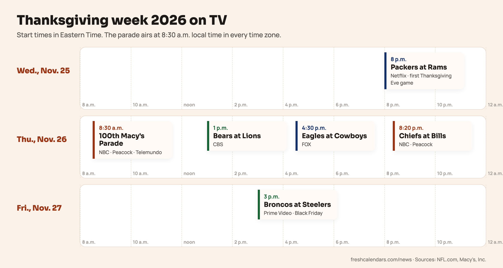

<b>Updated Sat., Oct. 24, 2026.</b> The NFL has announced that U2 will headline the halftime show of the Thanksgiving Eve game, Packers at Rams, on Wednesday, Nov. 25, live on Netflix. The Thanksgiving Day halftime performers have not been announced.

**The 100th Macy's Thanksgiving Day Parade airs on Thursday, Nov. 26, 2026, starting at 8:30 a.m. in all time zones on NBC and Peacock.** Telemundo carries it in Spanish. Around it, the National Football League (NFL) has packed five games into three days, including its first game on Thanksgiving Eve.

Here is the whole week in one place, with channels and start times in Eastern Time (ET).

## Thanksgiving week 2026 on TV, at a glance

| When (ET) | What | Where to watch |
|---|---|---|
| Wed., Nov. 25, 8 p.m. | Packers at Rams | Netflix |
| Thu., Nov. 26, 8:30 a.m. local time | 100th Macy's Thanksgiving Day Parade | NBC, Peacock, Telemundo |
| Thu., Nov. 26, 1 p.m. | Bears at Lions | CBS, Paramount+, NFL+ |
| Thu., Nov. 26, 4:30 p.m. | Eagles at Cowboys | FOX, FOX One, NFL+ |
| Thu., Nov. 26, 8:20 p.m. | Chiefs at Bills | NBC, Peacock, NFL+ |
| Fri., Nov. 27, 3 p.m. | Broncos at Steelers | Prime Video |

*From the Wednesday night game to Black Friday afternoon. Times are Eastern; the parade airs at 8:30 a.m. local time everywhere.*

## The 100th Macy's Thanksgiving Day Parade

The first Macy's parade marched in 1924. It was called off in 1942, 1943 and 1944, during World War II, which is why the 2026 parade is the 100th, not the 103rd. Macy's calls it a once-in-a-century milestone and has promised a record lineup of 100 inflatable elements.

Macy's has named these for the 100th parade so far:

- **Sorcerer's Apprentice Mickey**, a new balloon from Disney.
- **Underdog**, reimagined and flying for the first time since 1984.
- **Felix the Cat**, the parade's first character balloon from 1927, when volunteers carried him on sticks before helium balloons arrived.
- **The Blue Hippopotamus**, last seen floating past the Empire State Building after the 1931 parade.
- **Billie Brightpaw**, a newcomer, and **Tom Jr.**, son of Tom Turkey.
- Two new floats: **Tony Sarg's Amazing Marionettes**, honoring the parade's creator, and **Macy's All-Stars**, carrying Bullwinkle, Popeye, Olive Oyl, Swee'Pea and Sonic the Hedgehog.

### Time zones

The broadcast starts at 8:30 a.m. in every time zone. In Chicago that is 8:30 a.m. Central Time, and in Los Angeles 8:30 a.m. Pacific Time. Viewers outside the East see a delayed broadcast, so the live parade in Manhattan has long finished by the time it airs on the West Coast.

### Hosts and performers

NBC has not announced the 2026 hosts or musical acts. Last year's broadcast was hosted by Savannah Guthrie, Hoda Kotb and Al Roker, and NBC aired an encore at 2 p.m. ET/PT. Treat both as last year's details until NBC posts this year's schedule.

## NFL games on Thanksgiving 2026

### Wednesday, Nov. 25: the first Thanksgiving Eve game

The Green Bay Packers visit the Los Angeles Rams at SoFi Stadium at 8 p.m. ET, streaming on Netflix. NFL.com calls it the league's inaugural Thanksgiving Eve game. In Los Angeles, kickoff is 5 p.m. Pacific Time. U2 will headline the halftime show, the NFL says, in a performance produced by Jesse Collins Entertainment. The Thanksgiving Day halftime performers have not been announced.

### Thursday, Nov. 26: the tripleheader

- **Bears at Lions, 1 p.m. ET, CBS.** Ford Field, Detroit. The Lions host the early game, as they do every year.
- **Eagles at Cowboys, 4:30 p.m. ET, FOX.** AT&T Stadium, Arlington, Texas.
- **Chiefs at Bills, 8:20 p.m. ET, NBC.** Highmark Stadium, Orchard Park, New York.

All three also stream on NFL+, and each one on its network's own service: Paramount+, FOX One and Peacock.

### Friday, Nov. 27: Black Friday

The Denver Broncos play the Pittsburgh Steelers at Acrisure Stadium at 3 p.m. ET on Prime Video. It is the league's fourth Black Friday game.

## The other 100th parade: Detroit

Detroit's America's Thanksgiving Parade also marks its 100th edition this year. The State of Michigan's event listing puts the step-off at 8:45 a.m. on Thursday, Nov. 26, at Kirby Street and Woodward Avenue. The route runs about three miles down Woodward Avenue. Local broadcast details have not been posted yet.

## Plan the day around the TV

A few things that line up with the broadcasts:

- **The turkey.** The U.S. Department of Agriculture (USDA) roasting chart gives 4 1/2 to 5 hours at 325°F for an unstuffed 20 to 24 lb turkey, so for an early afternoon dinner the bird goes in the oven while the parade is on. Our [turkey thawing schedule](/news/when-to-thaw-thanksgiving-turkey-2026/) has the dates to move it to the refrigerator, starting Saturday, Nov. 21 for the largest birds.
- **Shopping.** Most large retailers stay closed on Thanksgiving Day and open early on Friday. The [Black Friday 2026 store hours](/news/black-friday-2026-store-hours-walmart-target-best-buy/) story lists opening times, which matter if you want to be home for the 3 p.m. game.
- **Why the 26th.** Thanksgiving falls on the fourth Thursday of November by federal law. Our explainer on [why Thanksgiving 2026 is Nov. 26](/news/why-thanksgiving-2026-is-november-26/) covers the history and the travel days.

Print the one-page schedule below and stick it on the fridge, or mark the games on our [November 2026 calendar](/november-calendars.html).
