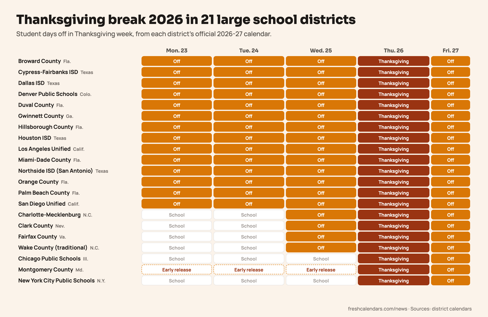

**Thanksgiving break 2026 runs Monday, Nov. 23 through Friday, Nov. 27 in most large U.S. school districts.** Of the 49 districts we checked, 31 give students the whole week off. Eleven start the break on Wednesday, Nov. 25, and seven, including New York City and Chicago, close only on Thanksgiving Day and the Friday after.

Thanksgiving is Thursday, Nov. 26, 2026. Every date below comes from the district's own 2026-27 calendar, linked in the sources. The list has 24 large districts and 25 more that each have their own story on our site, linked from the table.

## Thanksgiving break 2026 by district

| District | Students off | Days off |
|---|---|---|
| Los Angeles Unified, Calif. | Mon., Nov. 23 to Fri., Nov. 27 | 5 |
| Miami-Dade County, Fla. | Mon., Nov. 23 to Fri., Nov. 27 | 5 |
| Broward County, Fla. | Mon., Nov. 23 to Fri., Nov. 27 | 5 |
| Houston Independent School District (ISD), Texas | Mon., Nov. 23 to Fri., Nov. 27 | 5 |
| [Hillsborough County, Fla.](/news/hillsborough-county-public-schools-calendar-2026-27-breaks/) | Mon., Nov. 23 to Fri., Nov. 27 | 5 |
| Orange County, Fla. | Mon., Nov. 23 to Fri., Nov. 27 | 5 |
| Palm Beach County, Fla. | Mon., Nov. 23 to Fri., Nov. 27 | 5 |
| Gwinnett County, Ga. | Mon., Nov. 23 to Fri., Nov. 27 | 5 |
| Dallas ISD, Texas | Mon., Nov. 23 to Fri., Nov. 27 | 5 |
| San Diego Unified, Calif. | Mon., Nov. 23 to Fri., Nov. 27 | 5 |
| Duval County, Fla. | Mon., Nov. 23 to Fri., Nov. 27 | 5 |
| Cypress-Fairbanks ISD, Texas | Mon., Nov. 23 to Fri., Nov. 27 | 5 |
| Northside ISD, San Antonio | Mon., Nov. 23 to Fri., Nov. 27 | 5 |
| Denver Public Schools, Colo. | Mon., Nov. 23 to Fri., Nov. 27 | 5 |
| [Cobb County, Ga.](/news/cobb-county-school-calendar-2026-27-breaks-holidays/) | Mon., Nov. 23 to Fri., Nov. 27 | 5 |
| [Austin ISD, Texas](/news/austin-isd-calendar-2026-27-holidays-breaks/) | Mon., Nov. 23 to Fri., Nov. 27 | 5 |
| [Anne Arundel County, Md.](/news/anne-arundel-county-public-schools-calendar-2026-27-breaks/) | Mon., Nov. 23 to Fri., Nov. 27 | 5, Nov. 23-24 are parent-teacher conference days with no students |
| [Columbus City Schools, Ohio](/news/columbus-city-schools-calendar-2026-27-breaks/) | Mon., Nov. 23 to Fri., Nov. 27 | 5 ("Wellness Week") |
| [DeKalb County, Ga.](/news/dekalb-county-school-district-calendar-2026-27-breaks/) | Mon., Nov. 23 to Fri., Nov. 27 | 5 |
| [Fort Worth ISD, Texas](/news/fort-worth-isd-calendar-2026-27-breaks/) | Mon., Nov. 23 to Fri., Nov. 27 | 5 |
| [Fulton County, Ga.](/news/fulton-county-schools-calendar-2026-27-breaks/) | Mon., Nov. 23 to Fri., Nov. 27 | 5 |
| [Katy ISD, Texas](/news/katy-isd-calendar-2026-27-breaks/) | Mon., Nov. 23 to Fri., Nov. 27 | 5 |
| [Lee County, Fla.](/news/lee-county-schools-calendar-2026-27-breaks/) | Mon., Nov. 23 to Fri., Nov. 27 | 5 |
| [Memphis-Shelby County, Tenn.](/news/memphis-shelby-county-schools-calendar-2026-27-breaks/) | Mon., Nov. 23 to Fri., Nov. 27 | 5 |
| [Metro Nashville, Tenn.](/news/metro-nashville-public-schools-calendar-2026-27-breaks/) | Mon., Nov. 23 to Fri., Nov. 27 | 5 |
| [Osceola County, Fla.](/news/osceola-county-schools-calendar-2026-27-breaks/) | Mon., Nov. 23 to Fri., Nov. 27 | 5 |
| [Pasco County, Fla.](/news/pasco-county-schools-calendar-2026-27-breaks/) | Mon., Nov. 23 to Fri., Nov. 27 | 5 |
| [Plano ISD, Texas](/news/plano-isd-calendar-2026-27-breaks/) | Mon., Nov. 23 to Fri., Nov. 27 | 5 |
| [Polk County, Fla.](/news/polk-county-public-schools-calendar-2026-27-breaks/) | Mon., Nov. 23 to Fri., Nov. 27 | 5 ("Fall Break") |
| [Seminole County, Fla.](/news/seminole-county-public-schools-calendar-2026-27-breaks/) | Mon., Nov. 23 to Fri., Nov. 27 | 5 |
| [Volusia County, Fla.](/news/volusia-county-schools-calendar-2026-27-breaks/) | Mon., Nov. 23 to Fri., Nov. 27 | 5 |
| Clark County, Nev. | Wed., Nov. 25 to Fri., Nov. 27 | 3 |
| Fairfax County, Va. | Wed., Nov. 25 to Fri., Nov. 27 | 3 |
| Wake County, N.C. (traditional) | Wed., Nov. 25 to Fri., Nov. 27 | 3 |
| Charlotte-Mecklenburg, N.C. | Wed., Nov. 25 to Fri., Nov. 27 | 3 |
| [DC Public Schools](/news/dcps-calendar-2026-27-dc-public-schools-breaks/) | Wed., Nov. 25 to Fri., Nov. 27 | 3 |
| [Guilford County, N.C.](/news/guilford-county-schools-calendar-2026-27-breaks/) | Wed., Nov. 25 to Fri., Nov. 27 | 3 (Nov. 25 is a teacher workday) |
| [Howard County, Md.](/news/howard-county-public-schools-calendar-2026-27-breaks/) | Wed., Nov. 25 to Fri., Nov. 27 | 3, plus early dismissal Nov. 23-24 |
| [Jefferson County Public Schools (JCPS), Ky.](/news/jcps-calendar-2026-27-jefferson-county-public-schools-breaks/) | Wed., Nov. 25 to Fri., Nov. 27 | 3 |
| [Prince George's County, Md.](/news/prince-georges-county-public-schools-calendar-2026-27-breaks/) | Wed., Nov. 25 to Fri., Nov. 27 | 3 |
| [Virginia Beach, Va.](/news/virginia-beach-city-public-schools-calendar-2026-27-breaks/) | Wed., Nov. 25 to Fri., Nov. 27 | 3 |
| [Philadelphia, Pa.](/news/philadelphia-school-district-calendar-2026-27-holidays/) | Wed., Nov. 25 to Fri., Nov. 27 | 3 (Nov. 25 is a staff professional development day) |
| New York City Public Schools | Thu., Nov. 26 to Fri., Nov. 27 | 2 |
| Chicago Public Schools | Thu., Nov. 26 to Fri., Nov. 27 | 2 |
| Montgomery County, Md. | Thu., Nov. 26 to Fri., Nov. 27 | 2, plus early release Nov. 23-25 |
| [Baltimore County, Md.](/news/baltimore-county-public-schools-calendar-2026-27-breaks/) | Thu., Nov. 26 to Fri., Nov. 27 | 2 (Nov. 25 is a school day) |
| [Boston Public Schools](/news/boston-public-schools-calendar-2026-27-breaks/) | Thu., Nov. 26 to Fri., Nov. 27 | 2 |
| [Hawaii public schools](/news/hawaii-public-schools-calendar-2026-27-breaks/) | Thu., Nov. 26 to Fri., Nov. 27 | 2 |
| [Seattle Public Schools](/news/seattle-public-schools-calendar-2026-27-breaks/) | Thu., Nov. 26 to Fri., Nov. 27 | 2 |

*The chart covers the first 24 districts in the table. Florida, Texas and California districts lean toward the full week there, while New York City and Chicago keep students in class until Wednesday.*

## The full-week districts

Every Florida district on the list, from Miami-Dade to Duval and Volusia, closes for the whole week. So do the eight Texas districts, including Austin and Fort Worth, plus Los Angeles, San Diego, Denver, Columbus, Ohio, Memphis-Shelby County and Metro Nashville in Tennessee, Anne Arundel County, Md., and four Georgia districts: Cobb, Gwinnett, DeKalb and Fulton counties.

Los Angeles Unified's board-approved calendar names only Nov. 26-27 as the Thanksgiving holiday, but it also marks Nov. 23-25 as no-school days. The district's school sites list the whole week as "No School - Thanksgiving Break." Miami-Dade calls Nov. 23-25 recess days and Nov. 26-27 the Thanksgiving holiday and recess.

## Districts that start on Wednesday

Clark County, which covers Las Vegas, has no school on Wednesday, Nov. 25. The district also lists that day as its first contingency day, so it could become a school day if the district needs to make up lost time. Fairfax County, Wake County and Charlotte-Mecklenburg also close Nov. 25-27, with classes on Monday and Tuesday. The School District of Philadelphia lists Wednesday, Nov. 25 as a staff professional development day with school closed for students, followed by Thanksgiving Recess on Nov. 26-27, so students are off three days. Its calendar does not list Nov. 23-24 as closed. DC Public Schools, Prince George's County, Jefferson County, Ky., and Virginia Beach also close Nov. 25-27. Guilford County, N.C., lists Nov. 25 as a teacher workday within its Thanksgiving break for students, and Howard County, Md., dismisses students early on Nov. 23 and 24 before its Nov. 25-27 break.

## Districts with school until Wednesday

- **New York City Public Schools** close for Thanksgiving recess on Nov. 26 and 27 only. The [NYC public schools calendar](/news/nyc-public-schools-calendar-2026-27-breaks-holidays/) has every other day off this year.
- **Chicago Public Schools** close Nov. 26 and 27. See the [Chicago Public Schools calendar](/news/chicago-public-schools-calendar-2026-27-breaks/) for the rest of the year.
- **Baltimore County, Md.,** Boston, Hawaii and Seattle also close only Nov. 26-27. In Baltimore County, Wednesday, Nov. 25 is a school day with early dismissal, 3 hours early, per its calendar.
- **Montgomery County, Md.,** closes Nov. 26 and 27 and dismisses students early on Monday, Tuesday and Wednesday, Nov. 23, 24 and 25. The [Montgomery County Public Schools calendar](/news/montgomery-county-public-schools-calendar-2026-27-breaks/) has the rest of the year.

## Back to school on Nov. 30

Of the first 24 districts, 21 reopen on **Monday, Nov. 30**; the linked district stories give the return day for the rest. Families in the full-week districts have nine days in a row, from Saturday, Nov. 21 through Sunday, Nov. 29. In New York City, Chicago and Montgomery County the break is a four-day weekend, Thursday to Sunday.

## Plan the week

- **Turkey timing:** If your children are home all week, a frozen turkey can thaw in the refrigerator while they are off. The [turkey thawing schedule](/news/when-to-thaw-thanksgiving-turkey-2026/) gives start dates by weight.
- **What's on TV:** The 100th Macy's parade, the first National Football League (NFL) game on Thanksgiving Eve and the Black Friday game are in our [Thanksgiving 2026 TV schedule](/news/thanksgiving-2026-tv-schedule-macys-parade-nfl-games/).
- **Next break:** Most of these districts close again from Dec. 21. The [winter break 2026](/news/winter-break-2026-school-districts-dates/) story lists each district's dates and return day.

Print the one-page list below, or mark your district's days on the [November 2026 printable calendar](/november-calendars.html).
