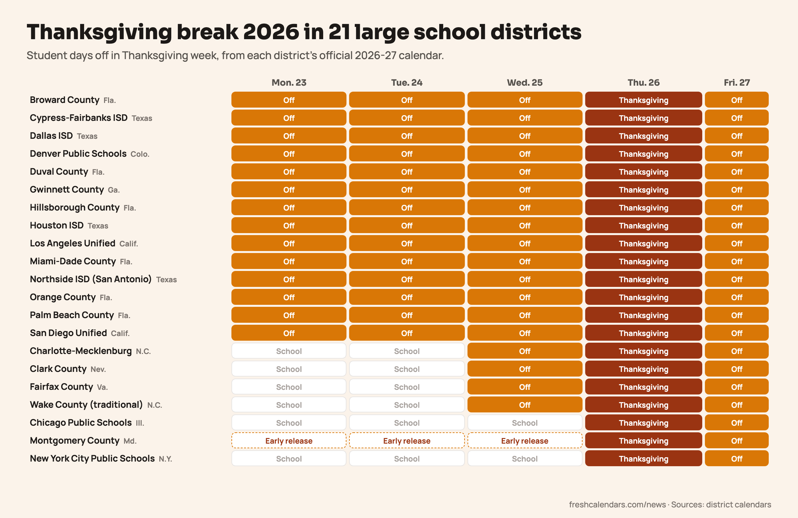

**Thanksgiving break 2026 runs Monday, Nov. 23 through Friday, Nov. 27 in most large U.S. school districts.** Of the 21 big districts we checked, 14 give students the whole week off. Four start the break on Wednesday, Nov. 25, and three, including New York City and Chicago, close only on Thanksgiving Day and the Friday after.

Thanksgiving is Thursday, Nov. 26, 2026. Every date below comes from the district's own 2026-27 calendar, linked in the sources.

## Thanksgiving break 2026 by district

| District | Students off | Days off |
|---|---|---|
| Los Angeles Unified, Calif. | Mon., Nov. 23 to Fri., Nov. 27 | 5 |
| Miami-Dade County, Fla. | Mon., Nov. 23 to Fri., Nov. 27 | 5 |
| Broward County, Fla. | Mon., Nov. 23 to Fri., Nov. 27 | 5 |
| Houston Independent School District (ISD), Texas | Mon., Nov. 23 to Fri., Nov. 27 | 5 |
| Hillsborough County, Fla. | Mon., Nov. 23 to Fri., Nov. 27 | 5 |
| Orange County, Fla. | Mon., Nov. 23 to Fri., Nov. 27 | 5 |
| Palm Beach County, Fla. | Mon., Nov. 23 to Fri., Nov. 27 | 5 |
| Gwinnett County, Ga. | Mon., Nov. 23 to Fri., Nov. 27 | 5 |
| Dallas ISD, Texas | Mon., Nov. 23 to Fri., Nov. 27 | 5 |
| San Diego Unified, Calif. | Mon., Nov. 23 to Fri., Nov. 27 | 5 |
| Duval County, Fla. | Mon., Nov. 23 to Fri., Nov. 27 | 5 |
| Cypress-Fairbanks ISD, Texas | Mon., Nov. 23 to Fri., Nov. 27 | 5 |
| Northside ISD, San Antonio | Mon., Nov. 23 to Fri., Nov. 27 | 5 |
| Denver Public Schools, Colo. | Mon., Nov. 23 to Fri., Nov. 27 | 5 |
| Clark County, Nev. | Wed., Nov. 25 to Fri., Nov. 27 | 3 |
| Fairfax County, Va. | Wed., Nov. 25 to Fri., Nov. 27 | 3 |
| Wake County, N.C. (traditional) | Wed., Nov. 25 to Fri., Nov. 27 | 3 |
| Charlotte-Mecklenburg, N.C. | Wed., Nov. 25 to Fri., Nov. 27 | 3 |
| New York City Public Schools | Thu., Nov. 26 to Fri., Nov. 27 | 2 |
| Chicago Public Schools | Thu., Nov. 26 to Fri., Nov. 27 | 2 |
| Montgomery County, Md. | Thu., Nov. 26 to Fri., Nov. 27 | 2, plus early release Nov. 23-25 |

*Florida, Texas and California districts lean toward the full week. The Northeast and Midwest keep students in class until Wednesday.*

## The full-week districts

Every large Florida district on the list, from Miami-Dade to Duval, closes for the whole week. So do the four Texas districts, Los Angeles, San Diego, Gwinnett County in the Atlanta suburbs and Denver.

Los Angeles Unified's board-approved calendar names only Nov. 26-27 as the Thanksgiving holiday, but it also marks Nov. 23-25 as no-school days. The district's school sites list the whole week as "No School - Thanksgiving Break." Miami-Dade calls Nov. 23-25 recess days and Nov. 26-27 the Thanksgiving holiday and recess.

## Districts that start on Wednesday

Clark County, which covers Las Vegas, has no school on Wednesday, Nov. 25. The district also lists that day as its first contingency day, so it could become a school day if the district needs to make up lost time. Fairfax County, Wake County and Charlotte-Mecklenburg also close Nov. 25-27, with classes on Monday and Tuesday.

## Districts with school until Wednesday

- **New York City Public Schools** close for Thanksgiving recess on Nov. 26 and 27 only. The [NYC public schools calendar](/news/nyc-public-schools-calendar-2026-27-breaks-holidays/) has every other day off this year.
- **Chicago Public Schools** close Nov. 26 and 27. See the [Chicago Public Schools calendar](/news/chicago-public-schools-calendar-2026-27-breaks/) for the rest of the year.
- **Montgomery County, Md.,** closes Nov. 26 and 27 and dismisses students early on Monday, Tuesday and Wednesday, Nov. 23, 24 and 25.

## Back to school on Nov. 30

All 21 districts reopen on **Monday, Nov. 30**. Families in the full-week districts have nine days in a row, from Saturday, Nov. 21 through Sunday, Nov. 29. In New York City, Chicago and Montgomery County the break is a four-day weekend, Thursday to Sunday.

## Plan the week

- **Turkey timing:** If your children are home all week, a frozen turkey can thaw in the refrigerator while they are off. The [turkey thawing schedule](/news/when-to-thaw-thanksgiving-turkey-2026/) gives start dates by weight.
- **What's on TV:** The 100th Macy's parade, the first National Football League (NFL) game on Thanksgiving Eve and the Black Friday game are in our [Thanksgiving 2026 TV schedule](/news/thanksgiving-2026-tv-schedule-macys-parade-nfl-games/).
- **Next break:** Most of these districts close again from Dec. 21. The [winter break 2026](/news/winter-break-2026-school-districts-dates/) story lists each district's dates and return day.

Print the one-page list below, or mark your district's days on the [November 2026 printable calendar](/november-calendars.html).
