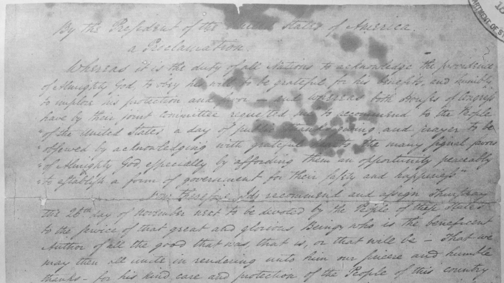
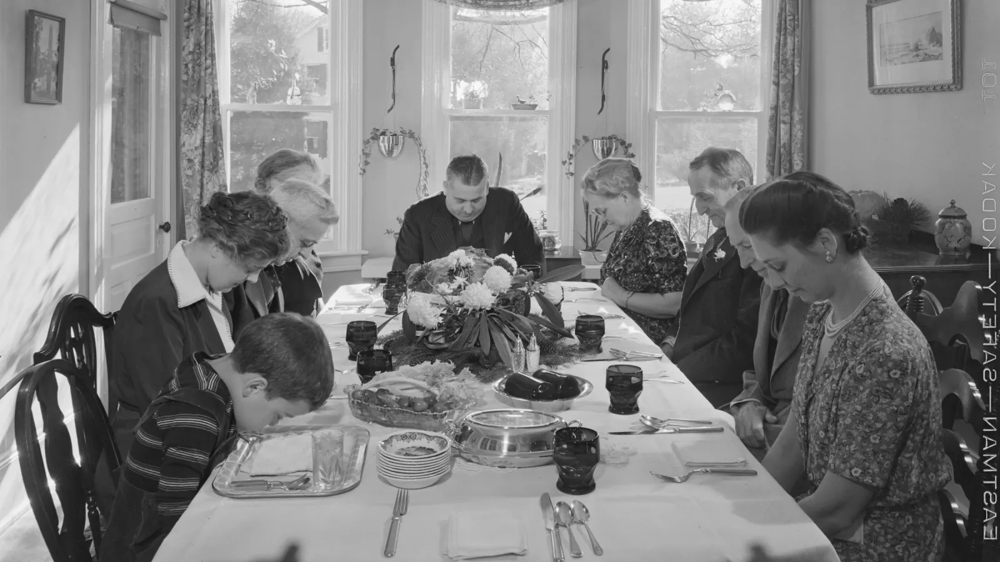

**Thanksgiving 2026 is Thursday, Nov. 26, the fourth Thursday of November.** Federal law, 5 U.S. Code Section 6103, sets the holiday on that weekday, and the U.S. Office of Personnel Management (OPM) lists "Thursday, November 26" as a 2026 federal holiday. The date is not chosen each year; because the law ties Thanksgiving to a weekday, it slides around the calendar while Christmas and other fixed-number holidays stay put. Black Friday follows on Nov. 27. Below is the reason for the date, a table of Thanksgiving dates through 2035, and a printable you can keep.

## What day is Thanksgiving 2026?

Thanksgiving Day 2026 is Thursday, Nov. 26. The table runs from the Friday before the holiday through Cyber Monday and counts the days until each one; the live clock below it needs JavaScript.

| Date | Day | What happens | Days from today |
|---|---|---|---|
| Nov. 20 | Friday | Friday before Thanksgiving | - |
| Nov. 24 | Tuesday | Tuesday before Thanksgiving | - |
| Nov. 25 | Wednesday | Thanksgiving Eve, first National Football League (NFL) game | - |
| Nov. 26 | Thursday | Thanksgiving Day (federal holiday) | - |
| Nov. 27 | Friday | Black Friday | - |
| Nov. 28 | Saturday | Small Business Saturday | - |
| Nov. 29 | Sunday | Last day of the four-day weekend | - |
| Nov. 30 | Monday | Cyber Monday | - |

Days, hours, minutes and seconds until Thanksgiving

<label for="lc-tg">Count down to</label>
<select id="lc-tg"></select>

The parade and kickoff times come from the [Thanksgiving 2026 TV schedule](/news/thanksgiving-2026-tv-schedule-macys-parade-nfl-games/); the midnight option counts from your own device's idea of midnight, which it says.

## Thanksgiving dates 2026 to 2035

The table below computes each year's U.S. Thanksgiving and Black Friday, the number of days from Thanksgiving to Christmas, and Canadian Thanksgiving, which falls on the second Monday of October. Thanksgiving 2025 was Thursday, Nov. 27, and 2024 was Thursday, Nov. 28.

| Year | U.S. Thanksgiving (Thursday) | Black Friday | Days to Christmas | Canadian Thanksgiving (Monday) |
|---|---|---|---|---|
| 2026 | Nov. 26 | Nov. 27 | 29 | Oct. 12 |
| 2027 | Nov. 25 | Nov. 26 | 30 | Oct. 11 |
| 2028 | Nov. 23 | Nov. 24 | 32 | Oct. 9 |
| 2029 | Nov. 22 | Nov. 23 | 33 | Oct. 8 |
| 2030 | Nov. 28 | Nov. 29 | 27 | Oct. 14 |
| 2031 | Nov. 27 | Nov. 28 | 28 | Oct. 13 |
| 2032 | Nov. 25 | Nov. 26 | 30 | Oct. 11 |
| 2033 | Nov. 24 | Nov. 25 | 31 | Oct. 10 |
| 2034 | Nov. 23 | Nov. 24 | 32 | Oct. 9 |
| 2035 | Nov. 22 | Nov. 23 | 33 | Oct. 8 |

The earliest Thanksgiving can fall is Nov. 22, next in 2029 and 2035; the latest is Nov. 28, next in 2030. Our [printable Thanksgiving dates for 2026 to 2035](/news/downloads/thanksgiving-2026/thanksgiving-dates-2026-2035.pdf) lists the same years for the fridge, with Black Friday and Canadian Thanksgiving.

## Why is Thanksgiving on Nov. 26 this year?

Title 5 of the U.S. Code names "Thanksgiving Day, the fourth Thursday in November." November 2026 begins on a Sunday, so its Thursdays fall on the 5th, 12th, 19th and 26th. The fourth one is Nov. 26.

Because the rule counts Thursdays, Thanksgiving can only land between Nov. 22 and Nov. 28. It falls on Nov. 22 when Nov. 1 is a Thursday and on Nov. 28 when Nov. 1 is a Friday.

**Is Thanksgiving always on the 26th?** No. Nov. 26 is just where the fourth Thursday lands this year. In the years since the law took effect, Thanksgiving fell on Nov. 26 in 1942, 1953, 1959, 1964, 1970, 1981, 1987, 1992, 1998, 2009, 2015, 2020 and 2026. The next Nov. 26 Thanksgivings are 2037, 2043 and 2048.

## Was the first Thanksgiving in 1621 or 1789?

Both years matter, for different reasons. In 1621 the Pilgrims and the Wampanoag held a harvest feast at Plymouth Colony in Massachusetts, according to the National Park Service (NPS). It was a harvest celebration with no fixed date, and the Park Service says it was the later yearly reenactment of that festival that spread into a national custom. The first national day of thanksgiving under the Constitution came in 1789, and Washington picked Nov. 26, the same date as this year.

The Park Service also records an older meal. On Sept. 8, 1565, Spanish settlers who had just founded St. Augustine, Florida, held a Mass of Thanksgiving and shared a meal with the Seloy people, 56 years before Plymouth. It never became an annual tradition.

| Year | What happened | Source |
|---|---|---|
| 1565 | Mass of Thanksgiving and a meal with the Seloy at St. Augustine, Florida | National Park Service |
| 1621 | Pilgrims and Wampanoag harvest feast at Plymouth | National Park Service |
| 1789 | Washington proclaims Thursday, Nov. 26 a day of thanksgiving | National Archives |
| 1863 | Lincoln sets the last Thursday of November | National Archives |
| 1941 | Congress fixes the fourth Thursday, first used in 1942 | National Archives |

## Nov. 26 was also Washington's date in 1789

The first national Thanksgiving under the Constitution fell on the same date as 2026. On Oct. 3, 1789, in New York, President George Washington issued a proclamation setting aside "Thursday the 26th day of November" as a day of public thanksgiving, according to the National Archives.

*Washington's 1789 proclamation, with the "26th day of November" line visible. Image: National Archives and Records Administration, public domain, via [Wikimedia Commons](https://commons.wikimedia.org/wiki/File:George_Washington%27s_October_3,_1789,_Thanksgiving_Day_Proclamation._-_NARA_-_299956.jpg).*

## How the fourth Thursday rule became law

For most of its history the holiday followed a "last Thursday" custom. President Abraham Lincoln's proclamation of Oct. 3, 1863, set Thanksgiving on "the last Thursday of November next," and later presidents kept to that pattern.

The custom broke in 1939, a year with five Thursdays in November. President Franklin D. Roosevelt proclaimed Thanksgiving for Nov. 23, 1939, a week before the last Thursday, after retailers warned that a late holiday would shorten the Christmas shopping season. He moved it again to the third Thursday, Nov. 21, in 1940 and Nov. 20 in 1941. According to the National Archives, only sixteen states kept the traditional last Thursday in 1940, and critics nicknamed the earlier holiday "Franksgiving."

Congress settled the question in 1941 with House Joint Resolution 41. The National Archives says the House passed it on Oct. 6, 1941, naming the last Thursday; the Senate amended it on Dec. 9, 1941, to the fourth Thursday; the House agreed; and Roosevelt signed it on Dec. 26, 1941. The first Thanksgiving held under the law was in 1942, which also fell on Nov. 26.

*Thanksgiving grace in 1942, the first Thanksgiving under the fourth-Thursday law; that year also fell on Nov. 26, and 2026 repeats the 1942 calendar as a common year starting on a Thursday. Photo: Marjory Collins for the Farm Security Administration, public domain, via [Wikimedia Commons](https://commons.wikimedia.org/wiki/File:Thanksgiving_grace_1942.jpg).*

## Is the day after Thanksgiving a holiday? The 4-day weekend

For federal employees, no. The Office of Personnel Management lists Thursday, Nov. 26 as the federal holiday, and Friday, Nov. 27 is not one. As of Oct. 28, 2026, no executive order giving federal workers that Friday off had been announced.

Many employers and some state governments do close on the Friday. North Carolina, for example, lists Thanksgiving as Thursday and Friday, Nov. 26 and 27, 2026, for state employees, according to the state's Office of State Human Resources. Check your own employer or your state's human resources page for the day after; our list of [states closed on Friday, Nov. 27](/news/is-the-day-after-thanksgiving-a-state-holiday-2026-states-closed-november-27/) covers state offices.

Paid time off on Thanksgiving itself is also up to the employer in the private sector. The U.S. Department of Labor says the Fair Labor Standards Act (FLSA) "does not require payment for time not worked, such as vacations or holidays," and treats holiday pay as a matter of agreement between employer and employee. Your company's 2026 holiday calendar, an employment contract or a union agreement decides whether Thursday and Friday are paid.

For those who get both days, the long weekend runs Thursday, Nov. 26 through Sunday, Nov. 29, four days. The [New York Stock Exchange (NYSE)](https://www.nyse.com/trade/hours-calendars) closes early at 1:00 p.m. Eastern Time on the Friday. Many school districts close the whole week; our [Thanksgiving break 2026 school district dates](/news/thanksgiving-break-2026-school-districts-dates/) lists them. The weekend's shopping days continue with [Small Business Saturday and Cyber Monday](/news/small-business-saturday-2026-november-28-cyber-monday-november-30/).

## What is closed on Thanksgiving 2026

| Service | Thursday, Nov. 26 | Friday, Nov. 27 |
|---|---|---|
| Federal offices | Closed | Open (not a federal holiday) |
| Federal Reserve | Closed | Open |
| Most banks | Closed | Most open |
| New York Stock Exchange and Nasdaq | Closed | Early close at 1:00 p.m. ET |
| U.S. Postal Service (USPS) | Postal holiday | Not on the USPS holiday list |

The federal schedule comes from the Office of Personnel Management and the Federal Reserve's 2026 holiday list, USPS lists Thanksgiving Day among its 2026 holidays, and the NYSE publishes the early close on its holidays and trading hours page. For stores and restaurants, see [what is open on Thanksgiving 2026](/news/whats-open-thanksgiving-2026-grocery-stores-walmart-costco/), which covers grocery chains, Walmart and Costco.

## When is Canadian Thanksgiving?

Canadian Thanksgiving falls on the second Monday of October, about six weeks before the U.S. holiday. The Canada Revenue Agency lists it as Monday, Oct. 12, 2026. In 2027 it moves to Monday, Oct. 11.

## Plan Thanksgiving week 2026

The 2026 Macy's Thanksgiving Day Parade is the 100th, according to Macy's, and starts at 8:30 a.m. in all time zones on NBC and Peacock. On the roads, AAA has not released its 2026 Thanksgiving forecast; its 2025 forecast projected a record 81.8 million people traveling at least 50 miles over the holiday period. The [Thanksgiving travel 2026 guide](/news/thanksgiving-travel-2026-best-days-to-fly-and-drive/) covers the best days to fly and drive.

Work through the week with the [Thanksgiving 2026 planner, countdown and checklist](/news/thanksgiving-2026-planner-countdown-checklist/), track deals with the [Black Friday 2026 ad tracker](/news/black-friday-2026-ad-tracker-walmart-target-best-buy/), and mark the dates on a [November 2026 printable calendar](/november-calendars.html). To see which weekday Thanksgiving lands on in any other year, check [when Thanksgiving falls](/when-is/thanksgiving/).
